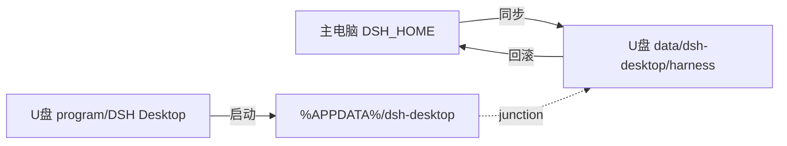

# DSH 便携版工具

把已经装好、调好的 [DeepSeek Harness](https://github.com/deepseek-ai) 搬到 U 盘，插到别的 Windows 电脑直接跑。

> 这是一个**迁移工具**，不是发行版。它不包含 DSH 本体和第三方插件——你需要先在自己电脑上装好 DSH。

## 它解决什么问题

你在主电脑上装好了 DSH、调好了插件、配好了密钥。想带去别的电脑用，但：

- 重装一遍要重新调插件、重新配密钥
- 插件市场里的原版，不是你本地调过的版本
- 会话、工作区、界面偏好都要重新弄

这个工具把「现有环境」整体搬到 U 盘，插到新电脑就能用。

## 和 DSH-Portable 的区别

| | [DSH-Portable](https://github.com/WSL043/DSH-Portable) | 本项目 |
|---|---|---|
| 定位 | 发行版：下载即用，自带内核 | 迁移工具：从已有安装克隆 |
| 起点 | U 盘为空，从头养成 | 主电脑已调好 |
| 插件 | 市场原版 | 你本地调过的版本（含自写插件） |
| 会话 | 带走 | 默认不带走 |
| 更新 | 自带更新通道 | 主电脑更新后同步 |

## 功能

| 功能 | 说明 |
|---|---|
| ▶ 一键启动 | 建数据链接并启动；本机已装 DSH 时走「临时接管」 |
| ■ 关闭并清理 | 关闭 DSH、还原本机数据、清缓存 |
| ⇅ 同步到 U 盘 | 配置 + 插件 + 密钥（对话自动剔除） |
| ↺ 从 U 盘回滚 | 把 U 盘状态恢复到本机（先备份） |
| ⌦ 清理残留 | 清 U 盘缓存、日志、旧备份 |
| ✕ 清空 U 盘对话 | 删 U 盘上运行时产生的会话、附件、草稿 |
| ↩ 还原本机数据 | 接管异常时手动兜底 |

## 前置要求

- Windows 10 64 位 / Windows 11（不支持 Win7/8，Electron 已停止支持）
- U 盘必须 **NTFS**（FAT32/exFAT 建不了 junction，链接安装的插件会挂）
- 主电脑已装 DSH Desktop，且能用

## 快速开始

**主电脑（第一次）**

1. 把 DSH 程序目录复制到 `U盘\DSH-Portable\program\DSH Desktop\`
2. 把本仓库的 `console\` 复制到 `U盘\DSH-Portable\console\`
3. 双击 `启动控制台.bat`
4. 点「⇅ 同步到 U 盘」，等进度条走完

**新电脑**

1. 插 U 盘（保持插入）
2. 双击 `启动 DSH（便携版）.bat`
3. 如果那台电脑已装 DSH：先完全退出它，再用控制台的「一键启动」（会临时接管）
4. 用完后点「■ 关闭 DSH 并清理」，等提示「可以安全拔出」再拔

## 架构



DSH 的 userData 是硬编码的 `%APPDATA%\dsh-desktop`，所以便携化只能靠 junction：把 `%APPDATA%\dsh-desktop` 指向 U 盘的数据目录。

## FAQ

**Q: 为什么 U 盘必须 NTFS？**
A: DSH 启动时会重建插件的链接（junction），FAT32/exFAT 不支持。代价是插 Mac 只读。

**Q: 为什么 U 盘版不能装插件？**
A: `.npmrc` 里的 store 路径是主电脑的，目标机用户不同会 `EPERM`。要装插件回主电脑装好再同步。

**Q: 对话会同步吗？**
A: 不会。同步只带配置、插件、密钥；U 盘版运行时产生的会话用「清空 U 盘对话」清掉。

**Q: 本机已经装了 DSH，还能用 U 盘版吗？**
A: 能，但要先退出本机 DSH，然后用控制台的「一键启动」（会临时把本机数据目录改名藏起来，用完自动还原）。

**Q: 换电脑后插件少几个？**
A: 检查 `node_modules` 里是否缺对应目录。链接安装的插件需要 `.generations` 一起复制，且 `pnpm.overrides` 不能清空。

## 踩坑记录

实现过程中踩过的坑都记在 [docs/踩坑记录.md](docs/踩坑记录.md)，包括：

- userData 硬编码
- FAT32 不支持 junction
- DSH 启动时重写 package.json
- link 安装的插件不在 lockfile 里
- BOM 导致启动失败
- UI 线程做 U 盘 I/O 导致卡死

## 目录结构

```
U盘\DSH-Portable\
├── program\DSH Desktop\      程序（约 1 GB，自行复制）
├── data\dsh-desktop\harness\  配置、插件、密钥
├── console\                   控制台与启动器（本仓库内容）
├── backups\                   回滚快照、隔离插件
└── manifest.json              同步记录
```

## License

MIT
