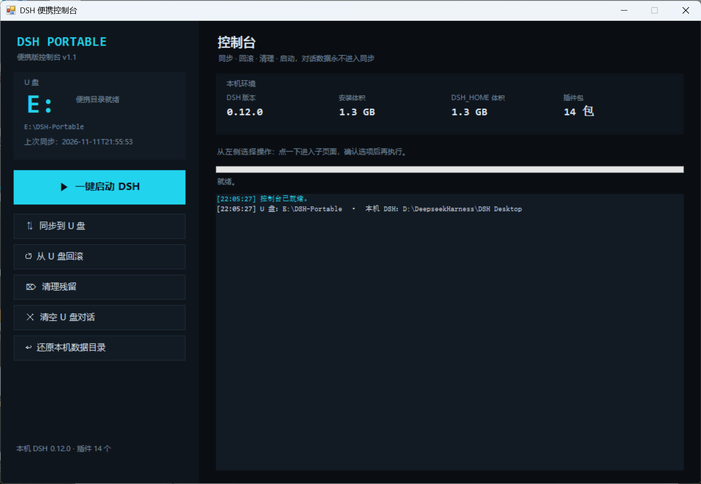
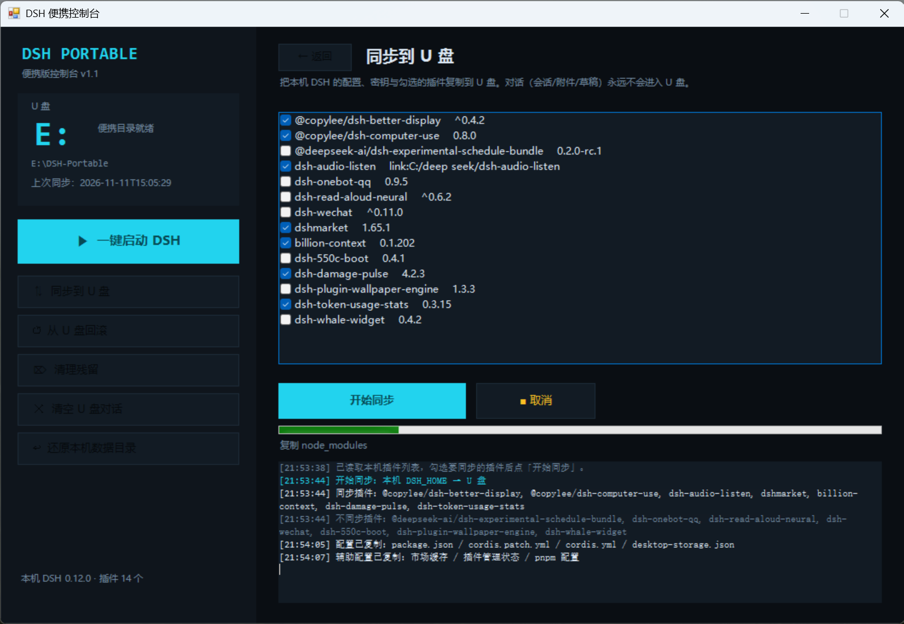
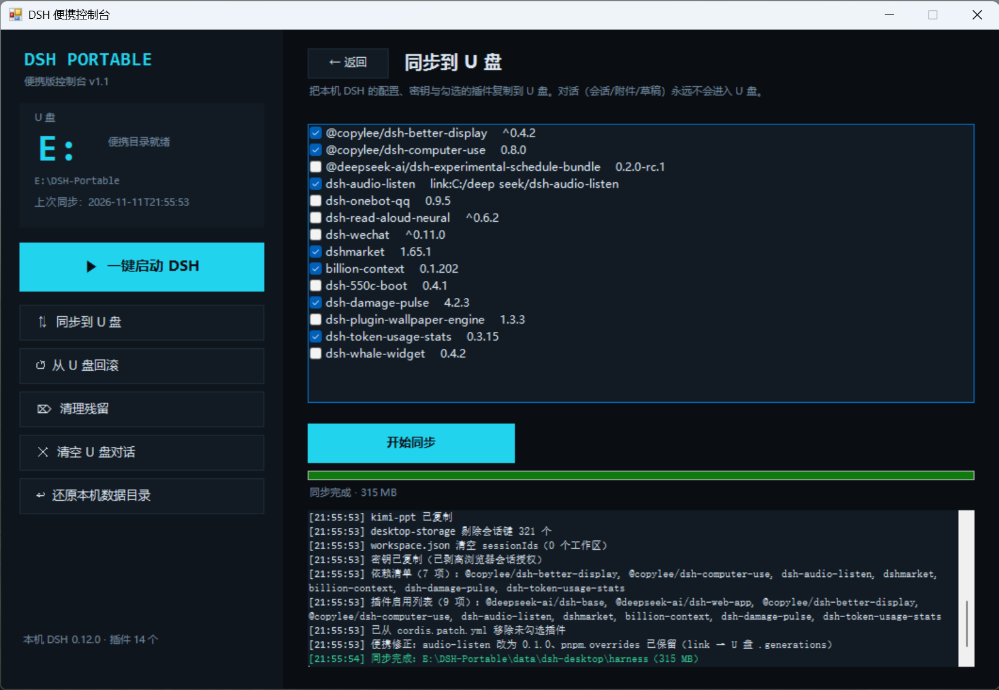
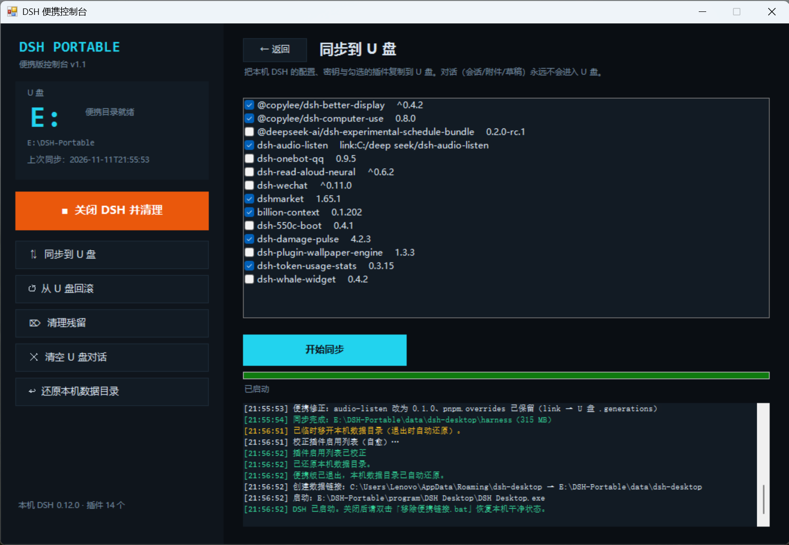
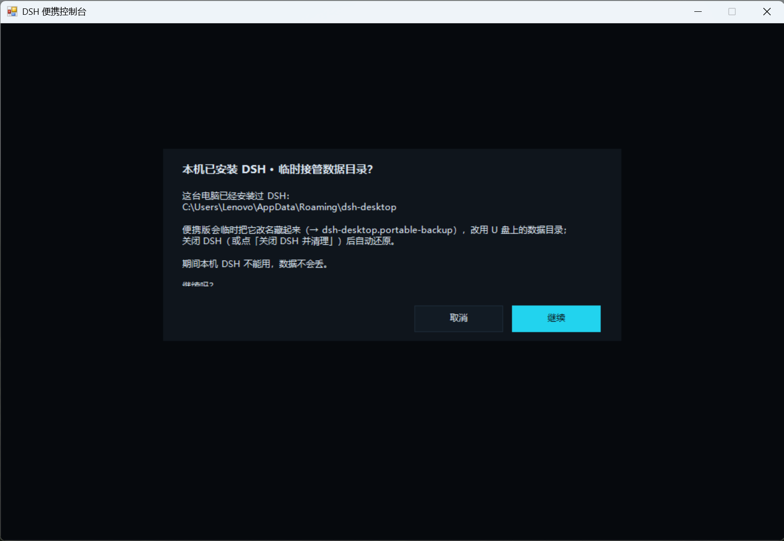
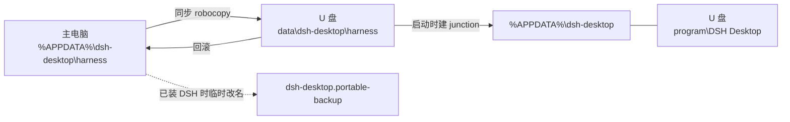

<div align="center">

# DSH 便携版工具

**把已经调好的 DeepSeek Harness，连同你自己改过的插件，一起装进 U 盘。**
**插上任意 Windows 10 / 11，继续用你熟悉的那套 AI 工作流干活。**

[](#已知限制)
[](#技术栈)
[](#技术栈)
[](#技术栈)
[](#项目数据)
[](LICENSE)

</div>

---

<p align="center">
  
  <br>
  <sub>控制台主界面：U 盘就绪状态 · 本机 DSH 环境 · 一键启动</sub>
</p>

<p align="center">
  
  
</p>

<p align="center">
  <sub>同步：勾选要带走的插件，实时日志 · 完成后显示实际迁移体积</sub>
</p>

<p align="center">
  
  <br>
  <sub>启动成功后：按钮变为「关闭并清理」，日志显示临时接管、启动与本机数据还原全过程</sub>
</p>

<p align="center">
  
  <br>
  <sub>目标电脑已装 DSH 时：临时接管数据目录，退出后自动还原</sub>
</p>

## 这是什么

一个**纯 PowerShell 写的 Windows 桌面应用便携化与迁移工具**。

它把主电脑上已经装好、调好插件、配好密钥的 DeepSeek Harness（Electron 桌面端）整体迁移到 U 盘，插到另一台 Windows 电脑上直接运行。

重点不在「装了个软件」——而在**带走那个你调了很久的版本**：

- 带走**自己写的、改过源码的、用 `link:` 装的**插件，而不只是插件市场的原版
- 带走配置、技能、`AGENTS.md`、密钥、自动化脚本
- 用完后拔盘走人，目标电脑的数据目录自动还原，像没来过

> 这是一个**迁移工具**，不是发行版。它不包含 DSH 本体和第三方插件——你需要先在自己电脑上装好 DSH。

## 为什么做这个

真正的开发环境从来不是一个安装包，而是一堆细碎的东西：改过源码的插件、只在自己的机器上存在的 link 安装、调过的提示词和技能、`AGENTS.md`、密钥、跑顺手的脚本。

换一台电脑，要重建的不是「装好 DSH」，而是**把调了很久的手感重新调一遍**。而如果那台电脑不是你的——只装了原始版 DSH、不允许装新软件、或者根本不能留下痕迹——你连重建的机会都没有。

所以这个工具只做一件事：

> **把整台「工作环境」装进 U 盘，插上任意 Win10 / 11，就能继续用自己的工作流。**

三条设计原则由此而来：

1. **带走的是你本地那个版本**，不是市场的默认版本；
2. **用完即走**：数据目录自动还原，对方的电脑保持原样；
3. **环境可以共享，会话只属于你**：同步永远不带对话、附件、草稿。

## 能带走什么

| 内容 | 同步 | 说明 |
|---|---|---|
| 插件（自写 / 改过源码 / `link:` 安装） | ✅ | 在控制台里勾选要带走的 |
| 配置（模型、界面偏好、技能、`AGENTS.md`） | ✅ | 按文件级复制 |
| 密钥 | ✅ | 存在 U 盘数据目录里，介意的话给 U 盘开 BitLocker |
| 会话 / 附件 / 草稿 | ❌ | 永远不进入同步 |
| 缓存 / 日志 / 媒体 | ❌ | 由「清理残留」删除 |

## 典型场景

| 场景 | 痛点 | 这个工具做了什么 |
|---|---|---|
| **临时借用别人的电脑** | 对方只有原始 DSH，插件全是默认 | 插盘即用你自己的插件与配置 |
| **工控机 / 行业主机** | 装不了软件、不能留痕、不能联网 | 只碰 U 盘和一个 junction，退出即还原 |
| **帮同学 / 同事看电脑** | 对方没有你的工具链，只能干看着 | 带着自己的 AI 工作流在现场定位问题 |
| **重装系统 / 换新机** | 环境重建要几个小时 | 一键回滚，或从 U 盘同步回本机 |
| **多台机器轮转** | 每台都要重新调一遍 | 一份 U 盘，处处一致 |

## 和 DSH-Portable 的区别

| | [DSH-Portable](https://github.com/WSL043/DSH-Portable) | 本项目 |
|---|---|---|
| 定位 | 发行版：下载即用，自带内核 | **迁移工具**：从已有安装克隆 |
| 起点 | U 盘为空，从头养成 | 主电脑已调好 |
| 插件 | 市场原版 | **你本地调过的版本**（含自写插件、link 安装的包） |
| 会话 | 带走 | 默认不带走（隐私） |
| 目标机已装 DSH | 不处理 | **临时接管 + 自动还原** |

## 功能

| 功能 | 说明 |
|---|---|
| ▶ **一键启动** | 建数据链接并启动；本机已装 DSH 时走「临时接管」，退出后自动还原 |
| ■ **关闭并清理** | 关闭 DSH、还原本机数据、清缓存 |
| ⇅ **同步到 U 盘** | 配置 + 密钥 + 勾选的插件（会话/附件永远不会进入 U 盘） |
| ↺ **从 U 盘回滚** | 把 U 盘状态搬回本机，执行前先备份本机 |
| ⌦ **清理残留** | 清 U 盘缓存、日志、恢复记录、旧备份（保留最近 2 个） |
| ✕ **清空 U 盘对话** | 删 U 盘上运行时产生的会话、附件、草稿（清键，不是只删文件夹） |
| ↩ **还原本机数据** | 接管异常时手动兜底 |

## 快速开始

### ⚠️ 第 0 步：把 U 盘格式化成 NTFS（必须）

这一步不是「可选优化」，是整个方案的前提。跳过它，下面全部跑不起来。

普通 U 盘出厂默认是 **FAT32**（大容量盘多为 **exFAT**），Windows 读写完全正常，但**建不了 junction**——而 junction 正是这个工具把 `%APPDATA%\dsh-desktop` 指向 U 盘的唯一手段。我第一块盘就是 FAT32 的 62.9 GB U 盘，实测报错：

```powershell
New-Item -ItemType Junction -Path "$env:TEMP\jtest" -Target 'E:\DSH-Portable\data'
# New-Item : Incorrect function.
```

`Incorrect function` 不是权限问题、不是路径写错，是文件系统**根本不支持 reparse point**。换成 exFAT 也一样——Windows 的 junction / symlink 只有 NTFS 支持，exFAT 上 pnpm 装插件还会额外报 `EISDIR`。

所以第一步是：

1. 把 U 盘里原有文件备份到别处（格式化会清空）
2. 资源管理器 → 右键 U 盘 → 格式化 → 文件系统选 **NTFS** → 开始
   - 或命令行：`Format-Volume -DriveLetter E -FileSystem NTFS -Confirm:$false`
3. 确认成功：`Get-Volume -DriveLetter E | Select-Object FileSystemType` 输出 `NTFS`

**代价**（也是我唯一妥协的地方）：NTFS 盘插 Mac 只能读不能写，插电视 / 车载 / 部分老设备可能不认。

我试过**不格式化**的路线：把 `link:` 安装的插件降级成普通目录复制、清空 `pnpm.overrides`、只保留 lockfile 里有的依赖。结果换机后插件被 lock-recovery 判定为孤儿直接裁掉——等于没带。所以结论很明确：

> **要么格式化 NTFS，要么放弃「把你调过的插件带走」。没有中间路线。**

> 进阶：也可以只划一小块 NTFS 分区（8 GB 够用）、其余留 exFAT 给普通文件用，但启动器就得处理分区识别与盘符漂移，复杂度陡增。我选择整盘 NTFS。

### 主电脑（第一次）

1. 把 DSH 程序目录复制到 `U盘\DSH-Portable\program\DSH Desktop\`
2. 把本仓库的 `console\` 复制到 `U盘\DSH-Portable\console\`
3. 双击 `启动控制台.bat`
4. 点「⇅ 同步到 U 盘」，勾选要带走的插件，等进度条走完

### 新电脑

1. 插 U 盘（使用期间保持插入）
2. 双击 `启动 DSH（便携版）.bat`
3. 如果那台电脑已装 DSH：先完全退出它，再用控制台的「一键启动」（会弹窗确认临时接管）
4. 用完后点「■ 关闭 DSH 并清理」，等提示「可以安全拔出」再拔

## 它是怎么工作的



三条主线：

1. **数据目录重定向**：DSH 的 `userData` 被硬编码为 `%APPDATA%\dsh-desktop`，`--user-data-dir` 不生效。所以用 NTFS junction 把这个路径指向 U 盘。
2. **本机已装 DSH 时临时接管**：不能直接建链接（目录已存在）。方案是改名让位 → 建链接 → 启动 → 退出后还原，并用标记文件兜底。
3. **增量同步**：`robocopy /E` 把配置、密钥、插件复制进 U 盘，显式排除 `sessions`、`attachments`、`cache`、`logs`、`media`，保证对话不出本机。

## 为什么「特调插件」特别难带

市场插件是「一个版本号」，拷过去就行。自己改过源码、用 `link:` 装的插件，才是这个项目真正的难点：

1. **不在 lockfile 里**：`pnpm.overrides` 里的 `link:../.generations/live/...` 在 `pnpm-lock.yaml` 里没有条目。同步时如果把 overrides 清空（为了"干净"），目标机 lock-recovery 判定解析不到，直接把插件从 dependencies 里裁掉。
   　→ 解法：`.generations` 整目录一起复制，overrides 原样保留。
2. **宿主会改写你的声明**：DSH 每次启动都跑 `healProfileBundles()`，把「已安装 + 声明了 `dsh.bundle.patch` + 不在 bundles 里」的插件全部写回 `package.json`。你勾掉不加载的插件，下次启动又回来了。
   　→ 解法：冻结策略，只删 `dsh.bundle.patch` 键，让 `inspectPackage` 判它不是 bundle。
3. **改配置会穿透链接**：如果 `node_modules` 里那些插件是 junction，直接改 `package.json` 会写到源目录，把 `.generations` 里的原始包也改坏，目标机启动直接报 `dsh.bundle.patch must be a file path or a list of file paths`。
   　→ 解法：只改副本，不动源目录。

这三条合起来，才叫「把我的插件带到新机器上真的能用」。

## 复刻指南

想自己从零搭一套？按这个顺序做，顺序本身就是经验。

### 0. 前置条件

- Windows 10 64 位 / 11，主电脑已装 DSH Desktop 且能正常使用
- U 盘必须是 **NTFS**，出厂格式（FAT32 / exFAT）一律不行，原因与操作见「快速开始 · 第 0 步」（踩坑 2）
- 全程使用 Windows PowerShell 5.1（系统自带，零依赖）

### 1. 先验证：userData 真的改不了

不要相信「加个 `--user-data-dir` 就行」。DSH 的主进程里有：

```js
app.setName("DSH Desktop");
app.setPath("userData", join(app.getPath("appData"), "dsh-desktop"));
```

**每次启动无条件执行**，命令行参数会被覆盖。验证方式：

```powershell
# 解包 Electron 主进程，确认路径来源
npx @electron/asar extract "<DSH安装目录>\resources\app.asar" .\asar-out
Select-String -Path .\asar-out\**\*.js -Pattern 'setPath\("userData"'
```

确认是硬编码之后，才确定用 junction 方案。

### 2. 手搓最小原型

在 U 盘上建好数据目录，手动建一次链接，确认 DSH 能从 U 盘跑起来：

```powershell
$appdata = Join-Path $env:APPDATA 'dsh-desktop'
$target  = 'E:\DSH-Portable\data\dsh-desktop'
New-Item -ItemType Directory -Force -Path $target | Out-Null
New-Item -ItemType Junction -Path $appdata -Target $target | Out-Null
```

跑通、退出、删链接、把数据删掉不心疼——原型阶段先把「能不能」问清楚。

### 3. 写启动器：一个 .ps1 + 一个 .bat

启动器要处理三种状态，缺一个都会在真实场景里翻车：

| 状态 | 判断 | 动作 |
|---|---|---|
| 没装过 DSH | `%APPDATA%\dsh-desktop` 不存在 | 直接建链接、启动 |
| 装过、已建链接 | 是 reparse point 且目标正确 | 直接启动 |
| 装过、还是普通目录 | 存在且不是链接 | **改名让位 → 建链接 → 启动 → 退出后还原** |

判定 reparse point 要用属性位，不能用 `Test-Path`：

```powershell
$i = Get-Item -LiteralPath $p -Force
[bool]($i.Attributes -band [System.IO.FileAttributes]::ReparsePoint)
```

### 4. 接管要有「崩溃兜底」

改名让位是破坏性操作。如果进程被杀，本机数据就停在 `dsh-desktop.portable-backup`，本机 DSH 下次启动会顺着 junction 去读 U 盘数据。

解法是**标记文件状态机**：

```powershell
# 接管时写，还原时删；下次启动先读它
$obj = [ordered]@{ backup = $Backup; target = $Target; usb = $Root; time = (Get-Date).ToString('o') }
[System.IO.File]::WriteAllText($Marker, ($obj | ConvertTo-Json), (New-Object System.Text.UTF8Encoding($false)))
```

启动器、控制台、UI 定时器三处都会检查标记并自动还原，所以「崩溃」最多只影响一次启动。

### 5. 写同步：robocopy + 显式排除

```powershell
robocopy $Harness $UsbHarness /E /NFL /NDL /NJH /NJS /R:1 /W:1 `
  /XD sessions attachments cache recovery logs media /XF desktop-host-sources.patch.yml
```

几个坑必须一起处理：

- **link 安装的插件**：`.generations` 一起复制，overrides 原样保留（详见「为什么特调插件特别难带」）。
- **写入 JSON 不能带 BOM**：`Set-Content -Encoding UTF8` 会写 BOM，Node 的 `JSON.parse` 直接崩。统一用：

```powershell
[System.IO.File]::WriteAllText($path, $text, (New-Object System.Text.UTF8Encoding($false)))
```

反过来，`.ps1` 自己**要** BOM，否则 PowerShell 5.1 按 ANSI 解析中文报语法错误。

### 6. 写控制台（可选但值得）

纯 PowerShell + WinForms 就能做出原生桌面界面，不需要 Python、不需要浏览器、不需要打包：

```powershell
Add-Type -AssemblyName System.Windows.Forms
Add-Type -AssemblyName System.Drawing
[System.Windows.Forms.Application]::EnableVisualStyles()
$form = New-Object System.Windows.Forms.Form
$form.ClientSize = New-Object System.Drawing.Size(1060, 700)
```

关键是**不阻塞 UI 线程**：长时间操作里循环调用 `[System.Windows.Forms.Application]::DoEvents()`，并用标志位支持「取消」。

### 7. 加固三件事

1. **接管期间不要扫 U 盘**：此时 `%APPDATA%\dsh-desktop` 是 junction，`Get-ChildItem` 等于遍历几千个 USB 文件，Windows 会判定「未响应」把窗口关掉。改用 manifest 记录的体积。
2. **还原放在清理之前**：顺序是 `杀进程 → 还原 → 清理`。改名是瞬时操作，不会卡；清理可能卡，所以数据安全动作必须在它前面。
3. **路径按 PID 缓存**：每 2 秒读一次进程路径同样会碰 U 盘，缓存起来。

## 踩过的坑

每一条都对应一次真实的崩溃、数据问题或「点了没反应」。

| # | 坑 | 根因 | 解法 |
|---|---|---|---|
| 1 | userData 改不了 | 主进程每次启动无条件 `setPath` | junction 重定向 |
| 2 | FAT32 建不了链接 | 文件系统不支持 reparse point，`New-Item -ItemType Junction` 直接返回 `Incorrect function` | 整盘格式化为 NTFS（见「快速开始 · 第 0 步」） |
| 3 | 插件被自动加回来 | `healProfileBundles()` 每次启动重写 bundles | 冻结策略：只删 `dsh.bundle.patch` 键 |
| 4 | link 插件换机后消失 | lockfile 里没有 entry | 复制 `.generations` + 保留 overrides |
| 5 | DSH 起不来 | UTF-8 BOM → `JSON.parse` 报 `Unexpected token` | `WriteAllText` + 无 BOM 编码 |
| 6 | 控制台「未响应」 | UI 线程扫了 junction 后的 U 盘 | manifest 体积 + PID 缓存 |
| 7 | 清理卡死导致数据丢失 | 还原排在清理之后 | 顺序反转：杀进程 → 还原 → 清理 |
| 8 | 接管后崩溃 | 本机目录停在 backup | 标记文件 + 自动还原 |
| 9 | 装插件 `EPERM` | `.npmrc` store 路径属于主电脑 | U 盘版不装插件，回主电脑装 |
| 10 | 双击没反应 | `requestSingleInstanceLock()` 基于 userData | 同一时间只允许一个实例 |

几个值得展开的：

**对抗宿主程序**：DSH 启动时会遍历 dependencies，把「已安装 + 声明了 `dsh.bundle.patch` + 不在 bundles 里」的插件全部写回 `package.json`。你勾掉不加载的插件，下次启动又回来了。解法是让 `inspectPackage` 判定它不是 bundle——只删 `dsh.bundle.patch` 这个键，保留 `dsh.bundle = {}`。注意：如果 `node_modules` 里那些插件是 junction，改 `package.json` 会**穿透到源目录**，把 `.generations` 里的原始包也改坏。

**数据安全优先于体验**：「关闭并清理」原本是 `杀进程 → 清理 → 还原`。清理卡死时还原永远不执行，本机数据停在 backup 状态，而本机 DSH 正顺着 junction 读 U 盘。改成 `杀进程 → 还原 → 清理` 之后，「卡死」不再等于「数据损坏」。

**同步要排除什么**：`sessions`、`attachments`、`cache`、`recovery`、`logs`、`media` 全部排除。同步是「带走环境」，不是「带走生活」。

## 项目数据

| 指标 | 数值 |
|---|---|
| 代码 | 3 个脚本，**1,525 行**、约 65 KB |
| 控制台 | `DSH-Portable-Console.ps1` 1,274 行（WinForms 界面 + 7 个功能） |
| 启动器 | `portable-launch.ps1` 224 行（接管 / 还原 / 自愈） |
| 单次迁移体积 | 315 MB 配置与插件（同步日志实测），程序目录约 1.3 GB |
| 方案迭代 | **6 轮**（FAT32 → NTFS、UI 线程、顺序反转、标记自愈……） |
| 解决的兼容性问题 | **10+**（BOM、junction、lockfile、heal、store 路径……） |
| 运行依赖 | **0**（系统自带 PowerShell 5.1） |

## 仓库结构

```
dsh-portable-tool/
├── 启动控制台.bat                    # 双击入口
├── 启动 DSH（便携版）.bat            # 直接用启动器，跳过控制台
├── console/
│   ├── DSH-Portable-Console.ps1      # WinForms 控制台（1274 行）
│   ├── portable-launch.ps1           # 启动器：接管 / 还原 / 自愈（224 行）
│   └── lib/ensure-profile-plugins.ps1# 插件列表校正（27 行）
├── docs/
│   ├── 踩坑记录.md                   # 10 条完整的技术记录
│   └── screenshots/                  # 控制台运行截图
└── README.md
```

U 盘上的部署结构：

```
U盘\DSH-Portable\
├── program\DSH Desktop\      # 程序（约 1 GB，自行复制）
├── data\dsh-desktop\harness\ # 配置、插件、密钥
├── console\                  # 本仓库内容
├── backups\                  # 回滚快照、隔离插件
└── manifest.json             # 同步记录
```

## 技术栈

| | |
|---|---|
| 语言 / 运行时 | Windows PowerShell 5.1（无第三方依赖） |
| GUI | WinForms 手绘界面（深色主题、进度条、可取消） |
| 文件系统 | NTFS junction / reparse point、跨盘链接、权限 |
| 数据迁移 | `robocopy` 增量同步、内容校验、排除规则 |
| 逆向 | 解包 `app.asar`、还原 Electron 主进程启动逻辑 |
| 配置处理 | `package.json` / `cordis.patch.yml` / `workspace.json` 改写 |
| 可靠性 | 标记文件状态机、崩溃自愈、数据安全顺序 |

## 已知限制

- **U 盘必须 NTFS**：出厂默认的 FAT32 / exFAT 不支持 junction，程序起不来；格式化后插 Mac 只读，插电视 / 车载可能不认。这是硬约束，详见「快速开始 · 第 0 步」。
- **U 盘版不要装插件**：`.npmrc` 的 store 路径绑定主电脑用户，目标机装插件会 `EPERM`。要装回主电脑装好再同步。
- **会话不同步**：这是设计，不是缺陷。
- **不支持 Win7 / 8**：Electron 已停止支持。

## 相关文档

- [踩坑记录（10 条，含报错原文与代码）](docs/踩坑记录.md)
- [DSH Desktop](https://github.com/deepseek-ai)

## License

[MIT](LICENSE)
